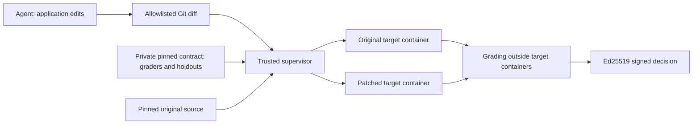

# Verify a patch outside the agent's workspace

Local `improve start/check/finish` hashes detect drift inside a session. An
agent that can rewrite the session can rewrite those hashes and reports.
Local decisions now carry `trust_profile: in_session`, `tamper_resistant: false`
and `signed: false`. For a stronger boundary, use `verifier submit` in the
agent workspace and `verifier check` or `verifier finish` on an independently
controlled runner. Both verifier commands recompute baseline and candidate.
They never promote a local report into a trusted decision.



The supervisor reconstructs source directly from pinned Git objects. Each fresh
container receives only application files, a minimal JSON adapter runner and
one request. Graders, references, holdout lists, Git metadata, verifier state,
Docker socket and signing key are absent. Only `input` and `context` cross the
boundary; case IDs, trial IDs and labels stay with the supervisor.

## Establish the trust boundary

Keep the trusted engine, private contract repository and signing key on a
different job/machine/account that the coding agent cannot modify or read.
The agent must not have the verifier's shell, Docker socket, credentials,
private-repository token, workflow-edit permission or signing key. Mount only
application paths writable in the agent's own environment. Put private holdouts
in a repository inaccessible to the agent, even if the application is public.

Running both commands as the same host user is a development demonstration.
The target's read-only mount protects the supervisor from that container; it
does not protect the supervisor from a host-side coding agent with access to
the supervisor. The framework cannot attest those external access controls.

The supervisor starts under `python -I` with a reduced environment. Each Linux
target uses a pinned image digest, `python -I -B`, fixed PATH/HOME/LANG only,
non-root UID, read-only application/root mounts, no network, no capabilities,
no privilege escalation, and bounded CPU, memory, processes, output, temporary
storage and time. It is removed after every call, including timeouts. Bake
application dependencies into the trusted image; it must contain Python and
`/usr/bin/env`. See [Docker runtime controls](https://docs.docker.com/engine/containers/run/)
and [Python isolated mode](https://docs.python.org/3/using/cmdline.html#cmdoption-I).

**Current isolated profile:** Python JSON adapters, native Evals suites,
deterministic graders and trusted Python custom graders. It does not run pytest.
Collected trial/grader identities must match the pinned manifest exactly.
Skipped/xfail counts are zero because this runner has no skip/xfail mechanism.
A future pytest backend needs actual discovery/skip/xfail manifests.

Network is unavailable in this profile. Existing live-provider evaluations
continue through the local workflow. Live API targets need a separately
provisioned constrained model gateway before they can use this isolated profile;
this release does not implement that gateway or claim isolated live-LLM tests.
Containers share a host kernel; use a VM or stronger sandbox when that threat
model requires it.

## Pin source and the entire private grading contract

Install on the trusted runner and generate its keys:

```console
python -m pip install -r verifier-requirements.lock .
evals verifier keygen --private-key /trusted/decision-key.pem --public-key /trusted/decision-public.pem
```

Private keys use owner-only permissions on POSIX. On Windows, restrict the
parent directory's ACL first. Distribute the public key independently: a key
shipped alongside an untrusted decision cannot authenticate its issuer. The
signature implementation uses [Ed25519](https://cryptography.io/en/latest/hazmat/primitives/asymmetric/ed25519/).

Example `contract.json`, committed to the private grading repository:

```json
{
  "schema_version": 1,
  "name": "refund.policy.v1",
  "application_paths": ["app"],
  "entrypoint": "app/adapter.py",
  "function": "evaluate",
  "public_suites": ["public.json"],
  "holdout_suites": ["holdout.json"],
  "environment_image": "python@sha256:d98cc29d3266e535dd9da1099688d9cb3ca4753813571e071763d17725460962",
  "max_target_calls": 100,
  "timeout_seconds": 30,
  "require_review": true
}
```

Application paths are exact files or directory prefixes relative to the source
repository. Only those files are exported. Use portable paths with letters,
digits, `_`, `@`, `+`, `.`, `/`, `-`, without trailing slashes. Symlinks,
submodules, traversal and case-colliding names are rejected. The verifier checks
its own allowlist independently of the agent's submission allowlist.

Tests, graders, conftest/pytest files, fixtures, snapshots, CI/Git files,
Python startup hooks, test/package config and lockfiles cannot be patched or
exported as application code. Binary patches, renames and copies are rejected.
New application files require `git add -N` before extraction.

Public/holdout files contain ordinary version-1 live suites with cases and
graders. The verifier supplies their target from the contract. Custom Python
grader paths are relative to the **contract root**. Put all rubrics, grader
dependencies, fixtures and lockfiles in this repository: its entire tree is
hashed, including files not directly imported. Provision grader dependencies
from the pinned lockfile in the trusted supervisor. The verifier does not
install arbitrary dependencies while processing a submission. Its own pinned
supervisor dependencies are in `verifier-requirements.lock`.

At least one public and one holdout suite are mandatory, with disjoint input
and context pairs. Author representative perturbations/variants privately
before attempts. Identical inputs are detected, but the engine cannot prove
that holdouts were never disclosed or that cases are representative.
Keep raw holdout reports private. Aggregate feedback can leak information over
repeated attempts; the operator controls submission access and overall budget.
`max_target_calls` caps baseline plus candidate adapter invocations **per
submission**, not internal model/tool calls or account-wide spend. There is no
cross-job attempt ledger in this release.

## Submit, review, verify and authenticate

From the agent workspace, against the full original application commit:

```console
evals verifier submit --source-repo . --source-ref ORIGINAL_FULL_COMMIT --allow app --output .evals/candidate.patch
```

Submission refuses non-allowlisted tracked edits, omitted untracked files,
forbidden paths, empty diffs and patches over 2 MiB. The remote verifier takes
the diff and reconstructs the original from its own trusted mirror. Branches,
tags and abbreviated refs are rejected for source and grading repositories.

A trusted reviewer checks hardcoded answers, swallowed failures, disabled
assertions, runner/config manipulation and suspicious input matching. An LLM
may assist; neither an LLM nor the included heuristic proves safety. By default,
passing execution gates without review produces `needs_review`. Review JSON:

```json
{
  "patch_sha256": "SHA256_OF_PATCH_BYTES",
  "reviewer": "trusted-reviewer-identity",
  "verdict": "approved",
  "rationale": "Explain the change and reward-hacking review."
}
```

Review files are trusted runner inputs, never automatically accepted from the
agent. Their authority comes from reviewer access controls, not the identity
string. `require_review: false` is an explicit operator policy for cheaper
automated gates; heuristic findings remain advisory. Review metadata is signed
publicly, so keep its rationale free of private holdout details.

On the trusted runner, choose a fresh output folder and unique runner-issued ID:

```console
evals verifier check --source-repo /trusted/source --source-ref ORIGINAL_FULL_COMMIT --contract-repo /trusted/contract --contract-ref CONTRACT_FULL_COMMIT --patch /incoming/candidate.patch --private-key /trusted/decision-key.pem --review /trusted/review.json --request-id submission-unique-id --output /trusted/results/submission-unique-id
```

`verifier finish` takes the same arguments and runs the same fresh gate.
Decisions require no baseline errors, no candidate failures/errors, exact
count invariants, no public/holdout case or grader regressions, and any required
review. A measured gain yields `verified_improvement`; an already-passing
original yields `baseline_satisfied`. Failed gates yield `not_verified`,
invalid submissions yield `rejected`. Ineligible decisions exit 1; invocation
failures exit 2.

`decision.json` is a signed envelope containing contract commit/whole-tree
SHA256, engine SHA256, source commit/exported-tree and candidate-tree SHA256, patch SHA256, target
image digest, supervisor Python/platform, request ID, review, count result and
aggregate outcomes and private-evidence hashes. Detailed observations,
case inventories and errors live
under `private/`. **Publish only `decision.json`**, never the entire directory.

Consumers authenticate the signature and compare expected patch, refs and ID:

```console
evals verifier verify-decision decision.json --public-key trusted-public.pem --patch candidate.patch --source-ref ORIGINAL_FULL_COMMIT --contract-ref CONTRACT_FULL_COMMIT --request-id submission-unique-id
```

This rejects edits, wrong issuers, different patches/refs and other request IDs.
The submission service must issue and retire IDs: accepting a reused ID permits
replay. This CLI does not implement a distributed nonce service, remote
attestation or key rotation.

## Trusted GitHub Actions job

`.github/workflows/verify-patch.yml` supports manual dispatch. Configure the
`isolated-verifier` environment with trusted required reviewers and deployment
branch restrictions before using it:

| Setting | Value |
| --- | --- |
| `VERIFIER_SOURCE_REPOSITORY` variable | Trusted application `owner/name` |
| `VERIFIER_CONTRACT_REPOSITORY` variable | Private grading `owner/name` |
| `VERIFIER_CONTRACT_COMMIT` variable | Reviewed full contract commit |
| `VERIFIER_READ_TOKEN` secret | Read-only checkout token for private repositories |
| `VERIFIER_SIGNING_KEY` secret | Private Ed25519 PEM from trusted key generation |

The job checks out engine, source and contract separately, reads dispatch data
as environment data rather than shell source, removes the temporary key and
uploads only the signed decision. Contract repository/ref come from trusted
configuration, not the patch. Small patches/reviews use base64 dispatch inputs.
Before releasing secrets, the reviewer verifies the selected workflow/engine
ref and source commit. An agent-editable workflow is not a trusted verifier;
an environment name in YAML alone does not establish its access policy.

This job has not been provisioned with your private contract/key or dispatched
to production infrastructure. Automated Docker CI uses synthetic applications
and ephemeral keys to exercise the same execution path.

## Reproduce the adversarial checks

```console
python -m pip install -r verifier-requirements.lock
python scripts/check_verifier_docker.py --pull --evidence .evals/verifier-docker-evidence.json
```

The script exercises a genuine boundary fix; read-only/chmod/network/environment
probes; public-example hardcoding; forged verdicts; runner monkeypatching;
skip-as-output; protected paths; out-of-allowlist edits; and symlink escape.
It also executes the protected-job entrypoint, checking key removal and
decision-only publication.
These are real Docker executions of a synthetic policy app with **no model
calls**. It authenticates signed decisions; generated approvals are integration
fixtures, not production reviews.
