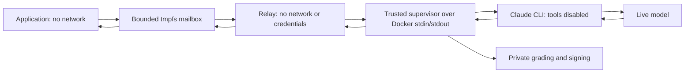

# Live verification and remote testing

Version 0.6.0 adds a bounded Claude gateway and trusted pytest assertions.
On 2026-10-26 the full local test completed **12 real model calls** using the
existing configured `claude-opus-5-5[1m]` model through Claude Code 2.1.310.
It changed only the application's refund-policy prompt and authenticated the
signed decision. An earlier connectivity smoke test used one additional call.

| Gate | Original | Candidate |
| --- | --- | --- |
| Native public cases | 1/2 | 2/2 |
| Native holdouts | 2/2 | 2/2 |
| Pytest public boundary assertion | 0/1 | 1/1 |
| Pytest holdout assertion | 1/1 | 1/1 |
| Errors / skipped / xfail / deselected | 0 | 0 |

The status was `verified_improvement`. Counts matched the frozen manifest;
every target invocation completed a model request. Data and application are
synthetic. Holdouts were hidden from the target container, not from the coding
agent that authored the demonstration. This local test does **not** prove
separate-account protection from that host agent. No production accounts,
repositories or secrets were configured.

Public evidence: [live isolated test](evidence/live-isolated-2026-10-26.json).
Raw prompts, responses, pytest output and reports remain in ignored `.evals/`.

## Run it locally

Prerequisites: Python 3.11+, Git, Linux Docker containers, and an existing Claude
CLI login on the supervisor host. Docker Desktop Linux containers are supported.
The test makes no login/account changes and uses your configured default model.
It consumes normal account allowance, capped at 12 evaluation model calls.
Choose a **new** workspace:

```console
python -m pip install -r verifier-requirements.lock
docker pull python@sha256:d98cc29d3266e535dd9da1099688d9cb3ca4753813571e071763d17725460962
python scripts/live_isolated_test.py --workspace .evals/my-live-verification --model live
```

The test pins source and grading commits, extracts a policy-only diff, recomputes
baseline/candidate, runs native cases and actual pytest, signs a decision and
verifies its signature and live-model provenance. The review is a known-change
integration fixture, not production human approval. There is no model-double
fallback in live mode: provider/login/rate-limit errors fail the gate.

Artifacts in the workspace:

- `verification.json`: aggregate result and provider/model identity.
- `candidate.patch`: application change, without grading changes.
- `result/decision.json`: signed envelope.
- `result/private/model-gateway.json`: requests, responses, usage, timing and
  baseline/candidate/case correlation.
- `result/private/pytest-*.json`: actual collection, outcomes and assertions.

CI uses `--model fixture` explicitly. That adapter/model double records
`live: false`; it cannot satisfy a consumer requiring actual inference. It still
tests real containers, pytest, patch validation and signatures.

## Model access without target network or credentials



The target keeps `--network=none`. A fresh 2 MiB tmpfs volume carries only a
request ID, prompt and reply. The relay mounts no host state, application or
grading contract. It rejects symlinks, FIFOs, oversized requests, traversal IDs
and unexpected fields. Root-owned replies and a sticky directory prevent target
overwrites. Both the relay and volume are removed after each target invocation.
The supervisor independently counts attempted/completed/rejected requests and
records observed model IDs and usage. It caps calls and returned bytes, not
provider tokens or dollars.

Copy the small `evals/model_client.py` client into your application:

```python
from model_client import complete

def evaluate(request):
    reply = complete("Your application prompt plus the request data")
    return {"output": reply["text"]}
```

The client serializes threads within one process. Multiprocess applications
must coordinate access: only one mailbox request may be outstanding per target.
The current live backend is **Claude CLI**, not an arbitrary HTTP proxy or an
OpenAI/Codex model backend. Codex can be the coding host while Claude serves the
target model. Ordinary non-isolated SDK/CLI adapters remain provider-neutral.

Add to the private contract:

```json
{
  "timeout_seconds": 150,
  "model_gateway": {
    "backend": "claude-cli",
    "max_model_calls": 12,
    "timeout_seconds": 120
  }
}
```

The target timeout must exceed the model timeout by five seconds. The model
budget must cover at least one completed model request per planned target call.
Errors or quota violations make the decision ineligible. The provider runs in a
fresh working directory with tools, MCP, skills and hooks disabled. Prompt text
is stdin, never shell source or a CLI argument. See the
[official CLI flags](https://code.claude.com/docs/en/cli-reference).

## Pytest stays outside application code

Actual pytest runs under a fresh `python -I` process on the trusted supervisor.
The engine's `evals_target` fixture calls the container over JSON; application
paths never enter the grader's Python import path. Existing tests that directly
import application code need this fixture to run in the strict profile:

```python
def test_refund_boundary(evals_target):
    result = evals_target({"days": 30})
    assert result["result"]["decision"] == "approved"
```

Optional contract section:

```json
{
  "pytest": {
    "public_tests": ["pytest_public.py"],
    "holdout_tests": ["pytest_holdout.py"],
    "manifest": "pytest-manifest.json",
    "timeout_seconds": 360
  }
}
```

The pinned manifest specifies `public` and `holdout` inventories with exact
`nodeids`, positive `target_calls`, and zero `skipped`, `xfail`, `xpassed`,
`deselected`. Both versions must match. Skip/skipif/xfail markers are rejected
even when they do not skip in that run. Candidate tests must all pass. Plugin
autoload, conftest discovery, ambient addopts and configuration are disabled;
only explicit pinned test paths and the engine plugin run. See
[pytest plugin controls](https://docs.pytest.org/en/stable/how-to/plugins.html).

## Prepare the separate runner without account changes

After committing the reviewed engine:

```console
python scripts/prepare_remote_test.py --workspace .evals/my-live-verification --output .evals/private-remote-kit
```

This creates source/grading Git bundles, patch, dependency lock, rejected review
template, pinned plan and operator README. It copies **no keys, credentials,
raw model traces or executable runner**. File hashes detect transfer corruption;
they do not authorize an untrusted kit. Transfer this directory privately.

On a different controlled machine, the operator installs the reviewed engine,
provides an existing model login, generates its signing key there, reviews the
patch and runs the installed command:

```console
evals verifier run-kit --kit /incoming/kit --private-key /trusted/decision-key.pem --public-key /trusted/decision-public.pem --review /trusted/approved-review.json --request-id unique-submission-id --output /trusted/result
```

Copy the rejected review template outside the kit before approving through the
trusted review process. For a production claim, use fresh private holdouts the
coding agent has never seen. Keep engine, contract, key and runner permissions
outside that agent's account. This example kit alone does not prove separation.
Publish only `result/decision.json`; retain bundles and private reports privately.

The GitHub workflow can select an existing protected self-hosted runner through
the repository variable `VERIFIER_RUNNER_LABEL`. Use a dedicated protected or
ephemeral runner that never executes untrusted jobs. A live runner needs its own authenticated Claude CLI;
hosted Ubuntu does not inherit your laptop login. Kit preparation does not
register a runner, create repositories, store secrets or dispatch production CI.

To replace the example grading data, the trusted operator can clone
`grading-contract.bundle` into its private grading repository, author fresh
holdouts there, update the pytest inventory and commit the new contract. Then
use `verifier check` with that new private `--contract-ref`. Keep those cases
off the coding agent's machine; updating them through the agent defeats that
part of the test.

Consumers can reject offline/fixture receipts explicitly:

```console
evals verifier verify-decision decision.json --public-key trusted-public.pem --patch candidate.patch --source-ref ORIGINAL_COMMIT --contract-ref PRIVATE_CONTRACT_COMMIT --request-id unique-submission-id --require-live-model
```

See the [operator guide](isolated-verifier.md) for access controls and signing.
